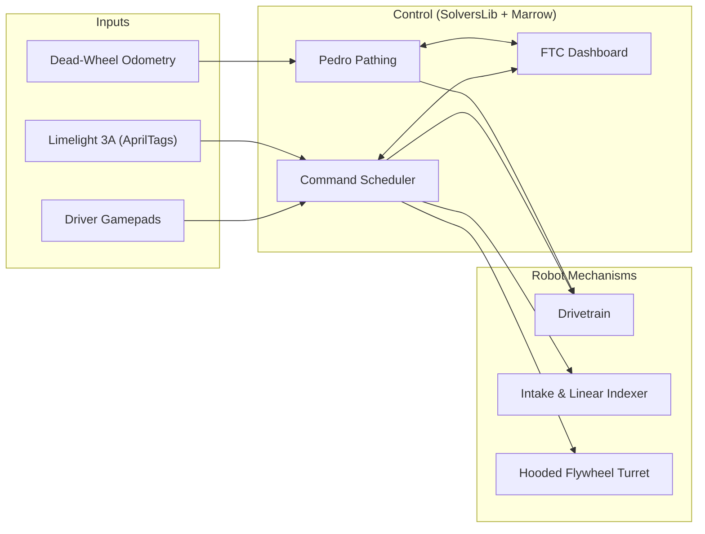

# Grizzly Bots — FTC Base Code

**2026–2027 BIOBUZZ Season | FTC Team 11918 (Arcturus)**

Competition robot code for the Tom Glenn High School robotics program. Handles robot control, autonomous pathing, live tuning, and AprilTag vision.

> **Looking for our custom code?** Jump straight to [`TeamCode`](TeamCode/src/main/java/org/firstinspires/ftc/teamcode) (subsystems, Pedro Pathing constants, and match OpModes).


---

## How It Works

Each mechanism on the robot lives in its own class, separate from the autonomous and driver-controlled modes. This lets multiple programmers work on different parts of the robot at the same time without breaking each other's code.



### Folder Structure

```text
TeamCode/src/main/java/org/firstinspires/ftc/teamcode/
├── subsystems/        # Individual robot mechanisms (drivetrain, intake, turret)
├── pedroPathing/      # Odometry settings, path follower constants, and tuning files
└── opmodes/           # Autonomous and TeleOp match programs
```

---

## Key Design Choices

* **Command-Based Code ([SolversLib](https://github.com/FTC-23511/SolversLib-Quickstart) + Marrow) instead of Linear OpModes:** Takes a bit more setup up front, but keeps mechanisms from interfering with each other and makes it easy to run actions at the same time (like spinning up the shooter while driving a path).
* **Pedro Pathing instead of basic waypoint driving:** Uses reactive Bezier curves instead of rigid timed paths. You give up exact fixed-time runs, but the robot recovers much better from wheel slip and collisions.
* **Live Tuning with FTC Dashboard:** PID values, flywheel speeds, and pathing constants can be adjusted live from a browser instead of rebuilding and re-uploading code to the robot for every small change.

---

## Testing & Tuning

* **Odometry & Pathing:** Calibrated dead-wheel tracking, PIDF controllers, and turn/centripetal constants using FTC Dashboard graphs to keep drift low across full-field runs.
* **Match-Ready Checks:** Changes are tested on the robot against live telemetry (target vs. actual motor speed, field position error, and loop time) before being merged into `master`.

---

## Setup

**Requirements:** Android Studio (Narwhal 3 Feature Drop or later) and JDK 17+.

1. Clone the repo:
```bash
git clone [https://github.com/Tom-Glenn-High-School-Robotics/Grizzly-Bots-FTC-Base-Code.git](https://github.com/Tom-Glenn-High-School-Robotics/Grizzly-Bots-FTC-Base-Code.git)
```
2. Open the folder in Android Studio and let Gradle sync.
3. Connect to the REV Control Hub over USB or Wi-Fi Direct and run `TeamCode`.
4. Open `http://192.168.43.1:8080/dash` in a browser while connected to the robot for live telemetry and tuning.
