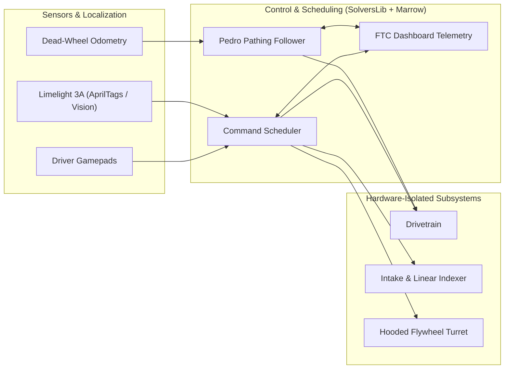

<div align="center">

# Grizzly Bots — FTC Competition Base Code
**2026–2027 BIOBUZZ Season | FIRST Tech Challenge Team 11918 (Arcturus)**

Standardized command-based robot control, closed-loop path following, real-time telemetry, and vision-assisted localization for the Tom Glenn High School robotics program.


</div>

---

## System Architecture

The codebase decouples hardware I/O, control logic, and autonomous scheduling so multiple programmers can iterate on subsystems in parallel without merge conflicts or regressions.



### Repository Layout

```text
TeamCode/src/main/java/org/firstinspires/ftc/teamcode/
├── subsystems/        # Hardware-isolated modules exposing command interfaces
├── pedroPathing/      # Tuned odometry constants, follower parameters, and feedforward profiles
└── opmodes/           # Thin, declarative Autonomous and TeleOp command sequences
```

---

## Tech Stack

| Layer | Technology | Purpose |
| :--- | :--- | :--- |
| **Language & Runtime** | Kotlin / Java (Android SDK) | Core robot control, subsystems, and OpModes |
| **Architecture** | [SolversLib](https://github.com/FTC-23511/SolversLib-Quickstart) | Command-based subsystem isolation and scheduling |
| **Autonomous Pathing** | Pedro Pathing | Bezier curve trajectory generation and closed-loop following |
| **State & Utilities** | Marrow | Streamlined hardware abstractions and state management |
| **Telemetry & Tuning** | FTC Dashboard | Live PID/feedforward tuning, field pose visualization, and graphing |
| **Vision** | Limelight 3A | AprilTag localization and game-piece detection |

---

## Key Engineering Decisions & Trade-offs

> [!NOTE]
> **Command-Based Architecture (SolversLib + Marrow) over Linear OpModes**  
> Moving away from monolithic loop-based OpModes added initial boilerplate, but eliminated state-bleed bugs between mechanisms and enabled concurrent actions (e.g., spinning up the shooter while tracking a path).

> [!NOTE]
> **Pedro Pathing over Standard Odometry Waypoints**  
> Chose reactive Bezier curve following over strict time-parameterized trajectories, trading away fixed-time predictability in favor of much stronger recovery from field collisions and wheel slip.

> [!NOTE]
> **Live Telemetry via FTC Dashboard**  
> Externalized tuning constants (PID gains, flywheel RPM targets, pathing tolerances) to iterate on control loops in seconds rather than rebuilding and redeploying the Android APK for every tweak.

---

## Testing & Validation

* **Pathing & Odometry Calibration:** Tuned dead-wheel odometry localization, translational/heading PIDF controllers, and centripetal force scaling via FTC Dashboard live graphs to minimize drift over full-field runs.
* **Hardware-in-the-Loop Verification:** Every subsystem change is validated against live telemetry (target vs. actual velocity, pose error, loop cycle time) before merging into `master`.
* **Unit Testing *(In Progress)*:** Extracting hardware-independent math (angle wrapping, pose transforms, state transitions) into pure Kotlin/Java utilities for automated JUnit testing.

---

## Getting Started

### Prerequisites
* Android Studio (Narwhal 3 Feature Drop or later)
* JDK 17+

### Setup
1. Clone the repository:
   ```bash
   git clone [https://github.com/Tom-Glenn-High-School-Robotics/Grizzly-Bots-FTC-Base-Code.git](https://github.com/Tom-Glenn-High-School-Robotics/Grizzly-Bots-FTC-Base-Code.git)
   ```
2. Open the project in Android Studio and allow Gradle to sync dependencies.
3. Connect to the REV Control Hub via USB or Wi-Fi Direct and run the `TeamCode` configuration.
4. Open live telemetry and tuning at `http://192.168.43.1:8080/dash` while connected to the robot controller.
